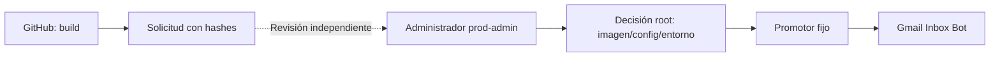

# Promoción de Gmail Inbox Bot fuera de GitHub

GitHub construye la imagen y solicita su promoción. La cuenta `deploy-gmail` solo registra
`request SOURCE_SHA sha256:DIGEST`; no tiene sudo, Docker ni acceso a secretos de ejecución.
La respuesta `awaiting_admin_approval` no significa que la imagen esté desplegada.

## Aprobar y activar

1. Revisar el cambio y verificar el artefacto exacto desde un entorno de confianza independiente.
   El SHA declarado, los tests y una etiqueta de una imagen generada por una cuenta comprometida
   no prueban por sí solos que el contenido corresponda al código revisado. Reproducir el build
   o validar el artefacto fuera de esa autoridad antes de aprobar su digest.
2. Revisar la configuración de los buzones. Preparar un snapshot root-owned en
   `/opt/gmail-promotion/configs/<config-digest>`; se puede reutilizar el actual si no cambia.
   Los nombres permitidos son archivos YAML simples, sin enlaces ni subdirectorios. El digest
   se calcula con `gmail_promotion.promotion.config_digest`, instalado fuera del checkout.
3. Entrar como `prod-admin` usando la clave y su frase guardadas en Google Password Manager.
4. Ejecutar los dos comandos siguientes con hashes completos. La aprobación permanece en el VPS
   y vincula el digest de imagen, el snapshot de configuración y el hash del entorno actual.

```bash
sudo gmail-promote approve SOURCE_SHA sha256:IMAGE_DIGEST CONFIG_DIGEST
sudo gmail-promote apply APPROVAL_ID
```

El primer comando devuelve `approved_not_deployed` y un ID de aprobación. El segundo acepta
exclusivamente ese ID. La identidad de CI no puede crear o cambiar las decisiones. La cola de
peticiones no es una entrada privilegiada del promotor: el administrador aporta los hashes
explícitamente tras la revisión.



El perfil fijo utiliza `ghcr.io/jmgb/gmail-inbox-bot@sha256:...`, puerto localhost 8007,
redes existentes, logs existentes y configuración de buzones en solo lectura. No hace git pull
ni ejecuta scripts del checkout, compila imágenes en producción o poda imágenes globalmente.
El proxy de logs existente continúa por separado y la aplicación no monta el socket Docker.

## Configuración y credenciales

El código instalado vive en `/usr/local/libexec/gmail-promotion-v1`; el ejecutable es
`/usr/local/sbin/gmail-promote`. Ambos son root-owned y deben actualizarse por promoción
administrativa de una versión revisada, nunca con auto-pull.

El entorno efectivo se conserva en `/opt/gmail-promotion/runtime-env.json`, accesible solo por
root. Se capturó el entorno de la aplicación activa para preservar literalmente sus 24 valores
de configuración; el `.env` original no se modificó. El perfil Compose escapa `$` y la verificación
real comprobó que el resultado coincide con los valores efectivos, sin mostrarlos en logs.

Una rotación debe actualizar el snapshot de entorno y sus otros consumidores de forma coordinada,
crear un backup cifrado nuevo y emitir otra aprobación. Editar el `.env` heredado del checkout
no actualiza el snapshot activo. Incluir este JSON y `/opt/gmail-promotion/docker/config.json`
en las copias cifradas de la operación: el inventario diario anterior no los incluye todavía.
La primera copia cifrada de ambos archivos se creó y su descifrado se verificó antes de activar.

La credencial de lectura del registro queda en el directorio Docker root-only; no se admiten
credential helpers ni otros registros. Se comprobó una lectura real del manifiesto de la imagen.
El alcance del token en el proveedor no se ha reducido ni demostrado mínimo; queda pendiente
de su inventario/rotación compartidos. CI construye con `GITHUB_TOKEN`; ya no necesita ese PAT.

## Fallos y recuperación

El promotor espera a health de Docker y HTTP. Si falla la activación, intenta restaurar el perfil
anterior y guarda `/opt/gmail-promotion/last-failure.json`, incluyendo `rollback_healthy`.
Un error no implica que el rollback haya tenido éxito: comprobar ese campo y el servicio.
Reaplicar un ID activo comprueba también la salud y no declara éxito para un contenedor unhealthy.

La primera recuperación usa `baseline.json`, generado desde la imagen/configuración existentes;
las siguientes usan el perfil aprobado anterior. Cada imagen aprobada conserva una etiqueta
`approved-<digest>` para que las podas de imágenes sin etiqueta de los despliegues heredados
no borren la recuperación. El promotor no poda imágenes; supervisar el espacio y contemplar
un espejo independiente. Un administrador aún puede forzar el borrado de imágenes etiquetadas.

## Límites de esta fase

Las identidades antiguas que aún conservan sudo/Docker pueden saltarse este mecanismo.
`scripts/vps_deploy.sh` sigue como código heredado y no debe ser el procedimiento operativo
de la migración. El cierre global depende de retirar esos accesos y separar los agentes de G02/G09.

La nueva identidad solo recibe una clave request-only. La clave anterior almacenada en Actions
se sustituye; eso no demuestra que copias antiguas ya extraídas hayan sido revocadas en todos los
hosts ni que no se compartieran con otros repositorios. Mantener abierto el inventario global.

La adopción de este workflow cambia el significado de un push: se construye y solicita, y el
despliegue queda pendiente de aprobación. Los cron/jobs de negocio del bot siguen funcionando.
